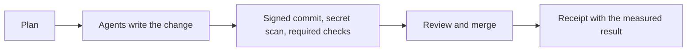

<picture>
  <source media="(prefers-color-scheme: dark)" srcset="assets/header-dark.svg">
  <source media="(prefers-color-scheme: light)" srcset="assets/header-light.svg">
  
</picture>

I build and run AI agent systems on self-hosted infrastructure, and measure before I decide. I work under the [AITactician](https://github.com/AITactician) name.

## Recent measured work

Each result is from October 2026. The full problem, decision, evaluation and number for each is on the [AITactician page](https://github.com/AITactician).

- **CI bill:** GitHub Actions overage was $21.55 in October. Merging many small jobs into one job per workflow cut one workflow from $0.108 a run to 0.67–1.33 Linux-equivalent minutes. Estimated monthly use now fits the free 3,000 minutes.
- **Security scanning:** Free scanners matched 1 of 15 CodeQL alerts, so the write-up names that gap. The paid tier costs about $49 per committer per month. I chose a free baseline, $0 extra.
- **Agent web search:** 2,021 searches in 4.27 days. Five providers on 20 queries, and no pairwise gap was significant, so availability and price chose the route. About $10 a month.

## How I work

Agents write most of the code. Every change goes through the same gates, and each piece of work leaves a receipt with what was measured and what was not.

## Where the work lives

Most of my code is private. I publish write-ups first and fresh public extracts only after a secret and personal-data check.

- [AITactician](https://github.com/AITactician): case studies
- [TWayneLabs](https://github.com/TWayneLabs): infrastructure as code for the lab
